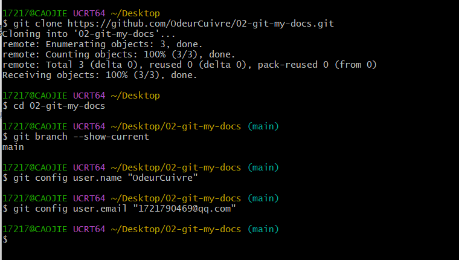
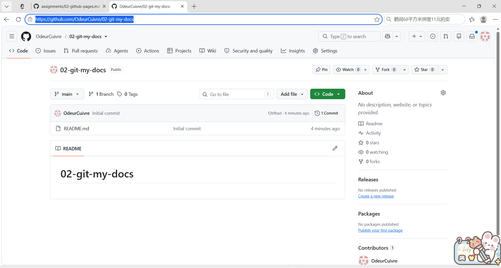
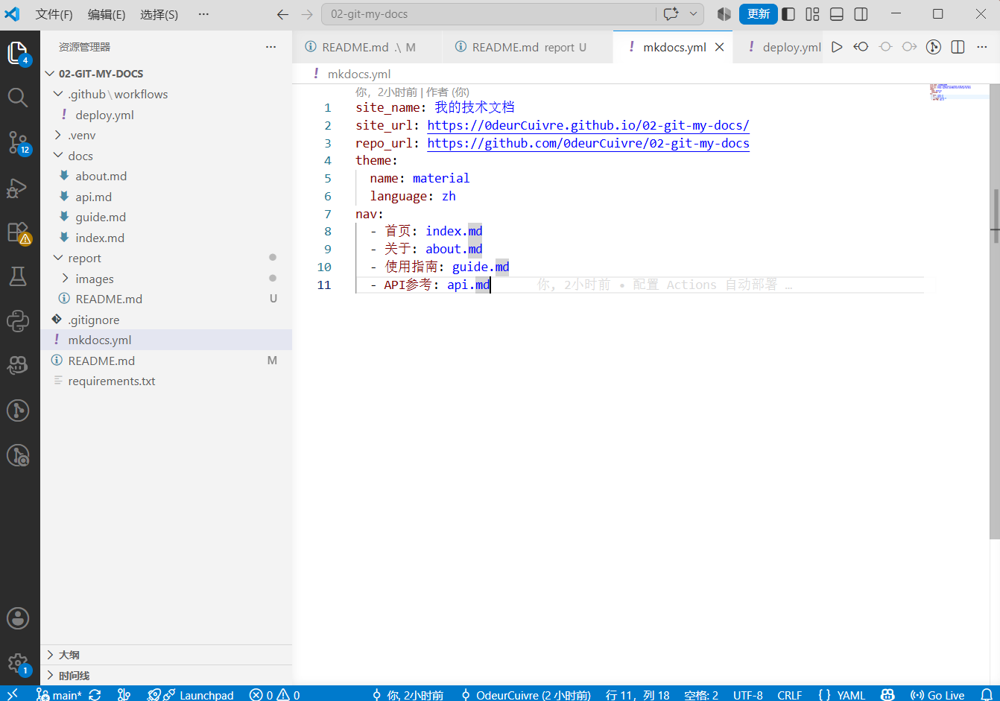
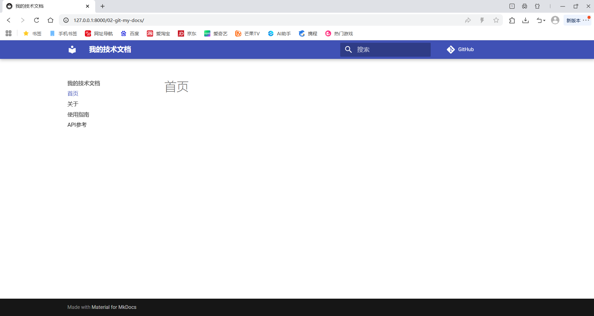
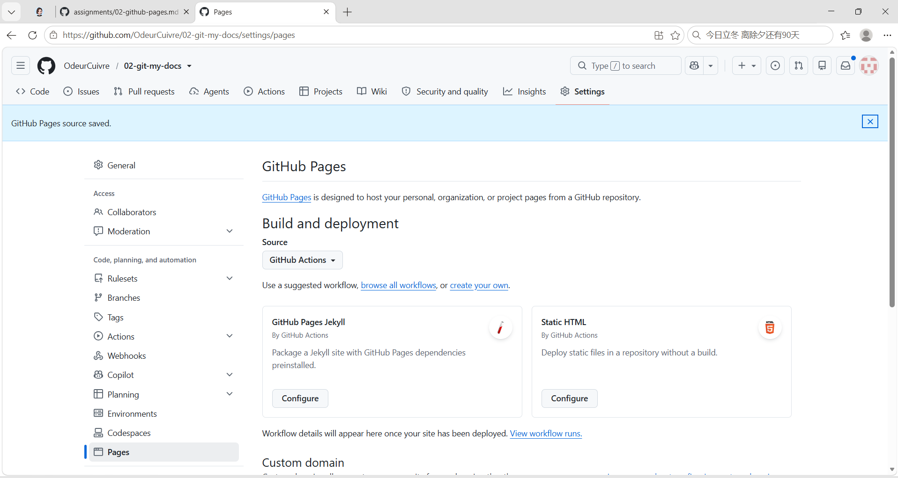
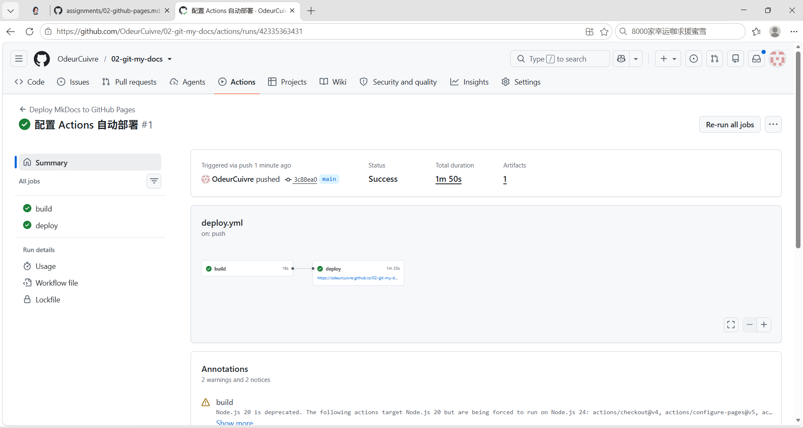
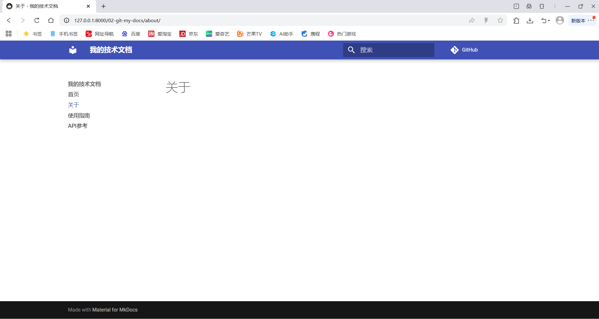
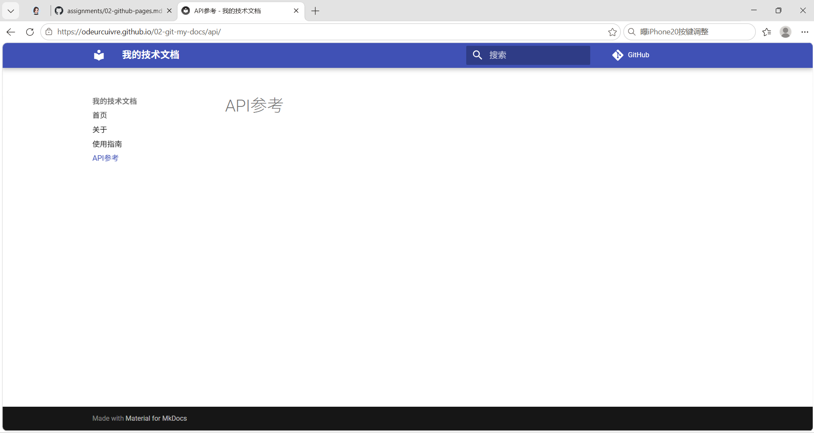
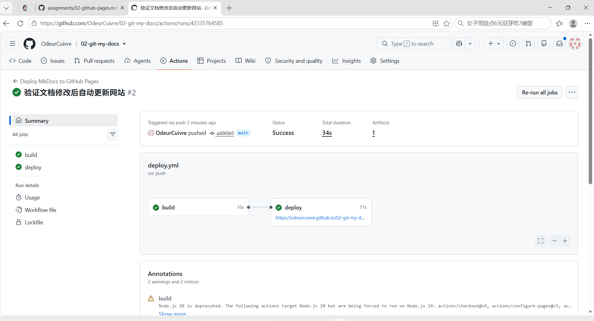
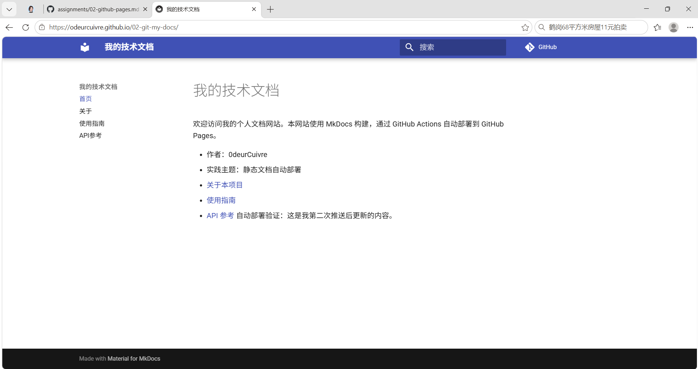

# 实践项目2：个人实验报告

## 1. 基本信息
- GitHub 登录名：OdeurCuivre
- 个人仓库地址：https://github.com/OdeurCuivre/02-git-my-docs
- 最终网站地址：https://OdeurCuivre.github.io/02-git-my-docs/

## 2. 实践过程与关键截图

### 2.1 仓库创建
在本地克隆仓库，并配置了 Git 全局身份（用户名和邮箱），确保后续提交记录正确。

在 GitHub 上确认仓库为公开（Public）状态，满足作业要求。

### 2.2 项目结构与 MkDocs 配置
搭建了标准目录结构：`docs/` 存放 Markdown 源码，`.github/workflows/` 存放部署脚本。在 `mkdocs.yml` 中配置了 Material 主题以及四个页面的导航菜单。

### 2.3 本地构建或预览
通过 `python -m mkdocs serve` 启动本地服务，在 `127.0.0.1:8000` 成功预览了首页、关于、使用指南和 API 参考四个页面，确认排版和导航无误。

### 2.4 Pages 设置
在仓库的 `Settings -> Pages` 中，将 Build and deployment 的 Source 选项修改为 **GitHub Actions**，允许工作流直接发布网站。

### 2.5 Actions 首次构建和部署
推送代码后，触发了第一次 GitHub Actions 工作流。可以看到 `build` 和 `deploy` 两个任务均执行成功（绿色对勾），并输出了部署后的 URL。

### 2.6 网站访问与四页导航检查
通过公开链接访问部署好的网站，确认首页、关于、API参考等页面均能正常加载，样式加载正常。

### 2.7 第二次推送与自动更新验证
修改了 `docs/index.md` 的内容并提交推送，观察到 Actions **自动**触发了第二次运行（#2），并在 34 秒内成功完成。刷新线上网站，确认新增的文字“自动部署验证：这是我第二次推送后更新的内容”已生效。
- 对应提交链接: https://github.com/OdeurCuivre/02-git-my-docs/commit/ad060e50fba12761bbe9dea59745ac28f37b26ec
- 对应 Actions 运行链接：https://github.com/OdeurCuivre/02-git-my-docs/actions/runs/42335764585

---

## 3. 问题与解决
**问题1**：在 Windows PowerShell 中执行 `source .venv/Scripts/activate` 激活虚拟环境时报错，提示无法加载脚本（SecurityError）。
**解决**：由于 Windows 默认的执行策略限制，直接切换 VS Code 的默认终端为 Git Bash，即可正常使用 `source` 命令激活。

**问题2**：首次部署完成后，访问线上网址出现 `404 Site not found` 页面。
**解决**：原因是 GitHub Pages 初次部署有 1-3 分钟的同步延迟。等待几分钟后按 `Ctrl + F5` 强制刷新浏览器，网站恢复正常访问。

---

## 4. 原理理解
1. **`docs/` 和 `site/` 各保存什么？为什么不用手工修改 `site/`？**
   `docs/` 保存的是 Markdown 源文件，是我们日常编写修改的内容；`site/` 是 MkDocs 根据源文件自动生成的静态 HTML/CSS/JS 网页。不需要手工修改 `site/`，因为每次构建（build）它都会被清空并重新生成，它是自动化的产物。

2. **本次工作流在什么情况下自动运行？**
   根据 `deploy.yml` 的配置，当向 `main` 分支推送（push）代码，且修改了 `docs/` 目录、`mkdocs.yml`、`requirements.txt` 等指定文件时，工作流会自动运行。如果只修改报告等无关文件，则不会触发。

3. **`build` 与 `deploy` 两个任务有什么区别？**
   `build` 负责准备环境，拉取代码，安装 Python 依赖并编译生成静态文件；`deploy` 任务依赖于 `build`，只有构建成功后，它才会将生成的网站产物上传并发布到 GitHub Pages 的服务器上。

4. **只修改 `report/README.md` 会触发部署吗？为什么？**
   不会。因为 `deploy.yml` 的 `paths` 配置中限定了只有在 `docs/**`、`mkdocs.yml` 等文件改变时才触发工作流。修改报告文件不影响网站内容，所以不会触发部署，这有助于节省 Actions 的计算资源。

5. **本次方案为何无需创建 `gh-pages` 分支？**
   因为采用了 GitHub 官方最新的 Pages 部署方案。利用 `actions/upload-pages-artifact` 打包静态产物，再使用 `actions/deploy-pages` 直接通过 GitHub API 部署，不再需要像传统方案那样将生成的文件推送到独立的 `gh-pages` 分支。